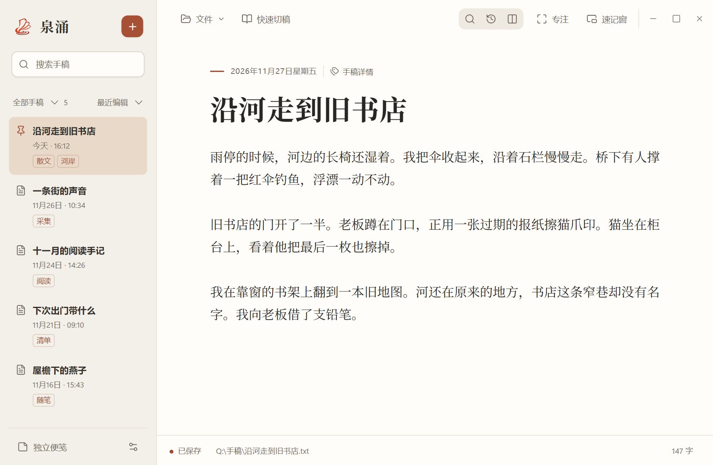

# QuanY (泉涌)

[简体中文](README.md) · [Download for Windows x64](https://github.com/la8garlic/QuanY/releases/latest/download/QuanY.exe) · [User guide](docs/guide.en.md)

QuanY is a plain-text notepad for Windows with English and Simplified Chinese interfaces. Press **Ctrl+Alt+J** to capture a thought in a small window at the bottom right of your screen. Press **Ctrl+Alt+M** to bring back the writing desk. Your manuscripts are TXT files. The local library keeps the catalogue, editing positions and revision history.



## Getting started

1. Download `QuanY.exe` above and put it in the directory where you want to keep the application.
2. Open `QuanY.exe`, enter a title and some text, and wait for **Saved**. Click the path in the status bar to open the containing folder.
3. Under **Settings → Files & saving**, choose a folder for new manuscripts and an autosave interval. The initial folder is **泉涌** inside your Windows Documents folder.
4. Under **Tray & shortcuts**, choose whether closing the window keeps the app in the tray, whether it starts at sign-in, and which shortcuts summon each window. The language selector is on the same page.

The portable build targets Windows x64 and uses the Microsoft Edge WebView2 Evergreen Runtime. If the runtime is missing, install it from [Microsoft](https://developer.microsoft.com/microsoft-edge/webview2/).

## At the desk

| Task | Controls |
| --- | --- |
| Long-form writing | Adjust the typeface, size, line spacing, paper colour and text width. Press F8 for focus mode. |
| Finding a draft | Search titles and bodies, use Ctrl+K to switch, or filter by tags and pins. |
| Editing an existing TXT | Open UTF-8 or BOM-marked UTF-16. Saving preserves the original encoding and newline convention. |
| Working with references | Open a read-only reference alongside the manuscript or create an independent, always-on-top memo. |
| Recovering an edit | Compare revisions, create a checkpoint or restore a prior revision. Each manuscript retains up to 40 revisions. |

## Building and contributing

Install Node.js, Rust with the MSVC toolchain, Visual Studio C++ Build Tools and the Windows SDK. The contribution guide lists the CI versions and setup links.

```powershell
npm ci
npm run release
```

The executable is written to `release/QuanY.exe`. Open Settings to read the embedded licenses and third-party notices. An optional SHA-256 checksum is available on the release page.

- [User guide and backups](docs/guide.en.md)
- [Contributing](CONTRIBUTING.en.md) · [Code of conduct](CODE_OF_CONDUCT.en.md)
- [Report a vulnerability privately](SECURITY.en.md) · [Repository and release operations](docs/maintaining.en.md)
- [Release history](https://github.com/la8garlic/QuanY/releases) · [Apache-2.0 license](LICENSE)
