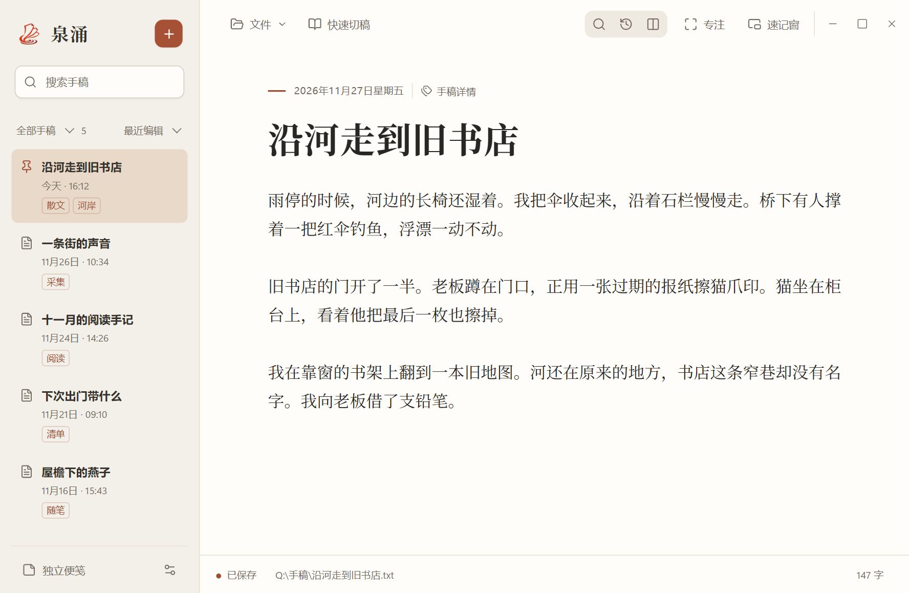

# 泉涌 QuanY

[English](README.en.md) · [下载 Windows x64 可执行文件](https://github.com/la8garlic/QuanY/releases/latest/download/QuanY.exe) · [使用指南](docs/guide.zh-CN.md)

泉涌是一款支持简体中文和英文的 Windows 纯文本记事本。按 **Ctrl+Alt+J** 可以在当前屏幕右下角记下一句话，按 **Ctrl+Alt+M** 回到主窗口继续写作。正文以 TXT 保存，稿本目录、光标和版本历史保存在本机。



## 开始使用

1. 下载上方的 `QuanY.exe`，放到准备长期使用的目录。
2. 双击 `QuanY.exe`，输入标题和正文，等待状态栏显示“已保存”。点击底部路径可打开文件所在目录。
3. 在“设置 → 文件与保存”选择新稿目录和自动保存等待时间。首次使用时，新稿放在 Windows“文档”下的“泉涌”文件夹。
4. 在“设置 → 待命与快捷键”选择关闭后是否驻留托盘、是否登录启动，或更换与其他软件冲突的快捷键。界面语言也在这一页切换。

发行包面向 Windows x64，使用 Microsoft Edge WebView2 Evergreen Runtime。只有运行时缺失时才需要另行安装。[微软官方下载](https://developer.microsoft.com/microsoft-edge/webview2/)

## 写作与找稿

| 场景 | 操作 |
| --- | --- |
| 写长稿 | 调整字体、字号、行距、纸色和正文宽度，按 F8 切换专注模式 |
| 找回手稿 | 搜索标题或正文，按 Ctrl+K 快速切稿，按标签筛选或置顶 |
| 修改旧文件 | 打开 UTF-8 或带 BOM 的 UTF-16 TXT，写回时沿用原编码和换行约定 |
| 对照资料 | 并排打开只读参考稿，或新建独立置顶便笺 |
| 恢复内容 | 在版本历史中查看差异、手动留版或恢复，每篇最多保留 40 个版本 |

## 构建与项目资料

构建需要 Node.js、Rust MSVC 工具链、Visual Studio C++ Build Tools 和 Windows SDK。安装步骤及 CI 对应版本见贡献指南。

```powershell
npm ci
npm run release
```

可执行文件位于 `release/QuanY.exe`。设置内可查看项目许可证和第三方声明。发行页的 SHA-256 文件供按需核验。

- [使用指南与数据备份](docs/guide.zh-CN.md)
- [参与开发](CONTRIBUTING.md) · [社区行为准则](CODE_OF_CONDUCT.md)
- [私密报告漏洞](SECURITY.md) · [仓库管理与发版](docs/maintaining.zh-CN.md)
- [发行记录](https://github.com/la8garlic/QuanY/releases) · [Apache-2.0 许可证](LICENSE)
